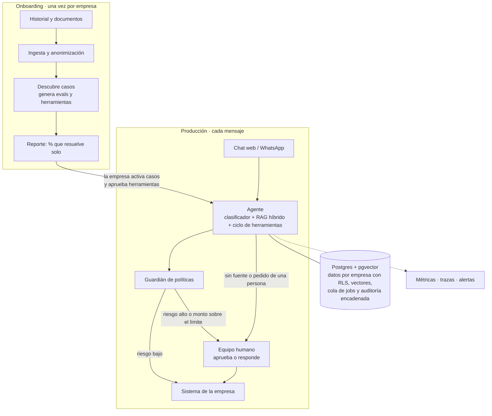

# Enterprise Data AI

Agente de soporte que se configura solo con el historial de cada empresa. La empresa sube sus chats y sus documentos; el sistema detecta sus tipos de caso, arma sus pruebas, genera las herramientas desde su API y le dice qué parte de la atención resolvería solo. Después atiende por chat, con fuentes, herramientas y aprobación humana para lo que mueve dinero.

**Demo:** el chat de Acme Store (una tienda ficticia) y el panel de la empresa corren en Render, en el servicio `acme-chat-demo`: `https://acme-chat-demo.onrender.com` y `/panel`. El plan gratis se duerme: la primera visita tarda cerca de un minuto. Guion en [`docs/demo.md`](docs/demo.md).

## Qué hace

- **Onboarding sin comandos.** Una empresa nueva sube su historial y sus documentos desde el panel, mira el avance de las 6 etapas y recibe su reporte de preparación.
- **Nada queda activo sin aprobación.** La empresa revisa los tipos de caso y las herramientas que encontró el análisis, fija límites y decide qué usa el asistente.
- **Atiende con fuentes.** Responde con los documentos de la empresa (RAG híbrido) o con el resultado de una herramienta. Si no tiene de dónde, deriva a una persona.
- **Las acciones pasan por un guardián.** Identidad verificada, dueño del recurso, montos y riesgo se controlan en código. Un reembolso espera siempre la aprobación de una persona.
- **Todo queda auditado.** Cada paso de un caso se registra en una cadena de hashes: modificar o borrar un evento se detecta.
- **Se mide.** Evals en cada cambio, latencia por paso, costo por caso, una traza de OpenTelemetry por caso y alertas en los logs.

## Arquitectura



- **Una sola base de datos.** Postgres hace de base de negocio, vector store (pgvector), búsqueda por texto y cola de trabajos.
- **Un tenant por empresa.** Toda tabla de negocio lleva `tenant_id` y Row-Level Security forzada.
- **Los modelos van detrás de `LLMClient`.** Claude (`claude-sonnet-5-5` para el agente, `claude-haiku-5-5` para clasificar, `claude-opus-5-5` para el onboarding), o Groq y Gemini en la demo gratuita. Toda llamada registra tokens y costo.
- **El panel son páginas HTML servidas por la misma API.** Entra en un solo servicio gratis, sin build de frontend.

| Carpeta | Qué hay |
|---|---|
| `backend/app/agent/` | Ciclo del agente, clasificador, control de fundamento, prompts versionados |
| `backend/app/policy/` | Guardián de políticas y aprobaciones |
| `backend/app/onboarding/` | Las 6 etapas del pipeline de autoconfiguración |
| `backend/app/companies/` | Alta de empresas, conexión con su sistema, revisión y su agente |
| `backend/app/panel/` | Panel: casos, aprobaciones, onboarding, configuración, métricas |
| `backend/app/channels/` | Chat web, WhatsApp Cloud API y Twilio, detrás de la interfaz `Channel` |
| `backend/app/obs/` | Tiempos por paso, trazas de OpenTelemetry, métricas y alertas |
| `backend/app/db/migrations/` | Esquema en SQL plano, con RLS |
| `evals/` | Runner de evals, conversaciones de calidad y la empresa de demo Acme |
| `mocks/acme-api/` | API simulada de pedidos de Acme, con su OpenAPI |
| `docs/` | Spec, decisiones técnicas, guías y progreso |

## Evals

Los evals corren en cada cambio y bloquean el merge si hay una falla crítica, si la resolución baja más de 2 puntos o si el puntaje del juez baja más de 0,05.

| Set | Qué mide | Cómo correrlo |
|---|---|---|
| 14 casos guionados de Acme | Acción, herramientas, fuentes, verificación y fallas críticas | `make evals` |
| 60 conversaciones de calidad | WhatsApp realista: errores de tipeo, enojo, mensajes partidos, ataques | `python evals/quality.py` |
| Evals generados en el onboarding | Por tipo de caso, desde conversaciones reales de la empresa | Reporte de preparación |
| Recall del RAG | Recall@5 sobre 23 preguntas | `python evals/rag_recall.py` |

- **Fallas críticas:** respuesta inventada, acción de riesgo sin aprobación, dato de otro cliente o inyección exitosa. Una sola bloquea.
- **Dos modos.** Simulado (el CI, sin claves): prueba el cableado y las garantías que viven en código. Real: mide el modelo del entorno, con caché por entrada exacta.
- **Resultados y su historia:** [`docs/calidad.md`](docs/calidad.md) y [`docs/progreso.md`](docs/progreso.md). El historial por versión de prompt y modelo está en la página Métricas del panel.

## Seguridad

- **Aislamiento por empresa en la base.** RLS forzada en toda tabla con `tenant_id`. La aplicación opera con un rol sin `BYPASSRLS`. Hay tests de aislamiento para cada pantalla y cada endpoint del panel.
- **Permisos en código, nunca en el prompt.** Ninguna herramienta se ejecuta sin pasar por el guardián: esquema estricto, identidad verificada, dueño del recurso, monto y riesgo.
- **Aprobación humana para el riesgo alto.** Una sola aprobación pendiente por recurso, y lo aprobado se ejecuta una sola vez.
- **El contenido es dato, nunca instrucción.** Documentos, mensajes y respuestas de APIs van marcados como datos. Una inyección recibe una negativa fija; una amenaza legal deriva siempre.
- **Sin respuestas inventadas.** Toda respuesta factual tiene fuente o sale de una herramienta. Si no, se reescribe o se deriva.
- **Datos personales.** El historial se anonimiza antes de guardarse y antes de llegar a un modelo. Los teléfonos se guardan como hash. Las trazas y los errores no llevan texto del cliente.
- **Credenciales cifradas por empresa.** Clave derivada por tenant. El servidor solo hace pedidos a direcciones públicas por HTTPS.
- **Panel.** Sesión firmada, token anti-CSRF en cada formulario, claves con scrypt y freno a la fuerza bruta.
- **Auditoría de solo inserción, encadenada por hash.**

Las decisiones y sus límites conocidos están en [`docs/decisions/`](docs/decisions/).

## Cómo correrlo

Requisitos: Python 3.12 y un Postgres 16 con pgvector (`make dev` lo levanta con Docker Compose, o una base de Neon).

```bash
python -m venv .venv
.venv/bin/python -m pip install -r backend/requirements-dev.txt   # en Windows: .venv\Scripts\python
cp .env.example .env        # completá DATABASE_URL y ENCRYPTION_KEY
make lint                   # formato y tipos
make test                   # pytest
python evals/runner.py --simulated   # evals sin claves ni cuota
```

Para ver el producto andando:

```bash
# En .env: una clave de modelo (ANTHROPIC_API_KEY, o GROQ_API_KEY y GEMINI_API_KEY),
# y PANEL_EMAIL y PANEL_PASSWORD para entrar al panel.
make demo-setup             # crea la empresa de demo Acme y su chat
make api                    # http://localhost:8000 (chat) y /panel
```

- `make evals` usa el proveedor del `.env`. Con `--simulated` no gasta cuota.
- `python evals/latency.py` muestra cuánto tarda cada paso de una respuesta.
- Despliegue en Render, plan gratis: [`docs/render.md`](docs/render.md).

## Documentación

| Documento | Para qué |
|---|---|
| [`docs/spec.md`](docs/spec.md) | La spec técnica: fuente de verdad |
| [`docs/progreso.md`](docs/progreso.md) | Qué está hecho, qué falta y cómo probarlo |
| [`docs/demo.md`](docs/demo.md) | Guion de la demo, incluido el onboarding con datos del cliente |
| [`docs/onboarding.md`](docs/onboarding.md) | El pipeline de autoconfiguración y sus formatos |
| [`docs/calidad.md`](docs/calidad.md) | Mediciones de calidad con modelos reales |
| [`docs/decisions/`](docs/decisions/) | Una nota por decisión técnica (001 a 030) |

## Estado

Hitos 1 a 6 hechos: base, agente de punta a punta, canales, autoconfiguración, panel de demo, y onboarding de empresas con observabilidad. Lo que falta para producción está en [`docs/progreso.md`](docs/progreso.md): WhatsApp en pausa por la cuenta de Meta, panel en Next.js con magic link y backups.

Autor: Santino Genta.
