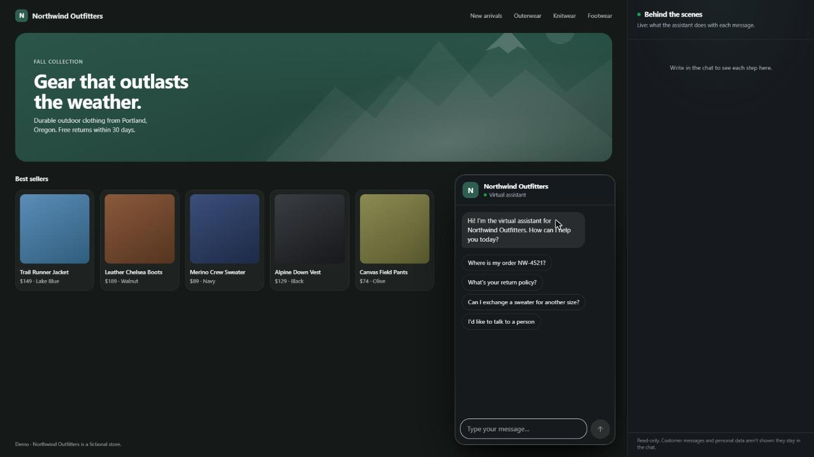
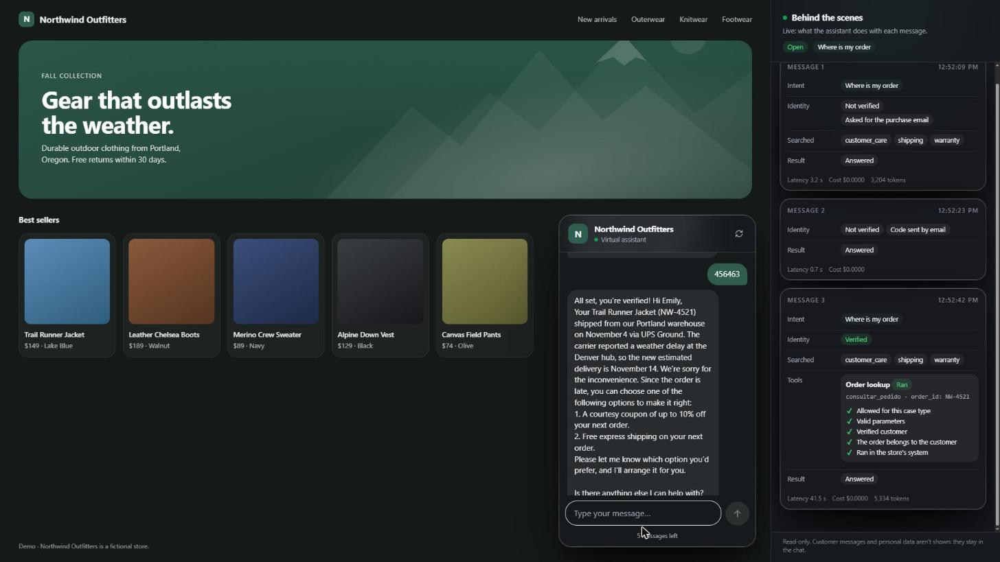
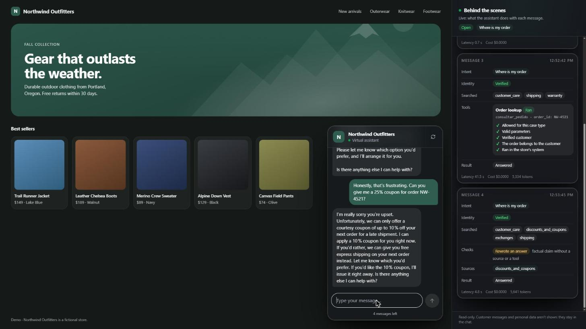
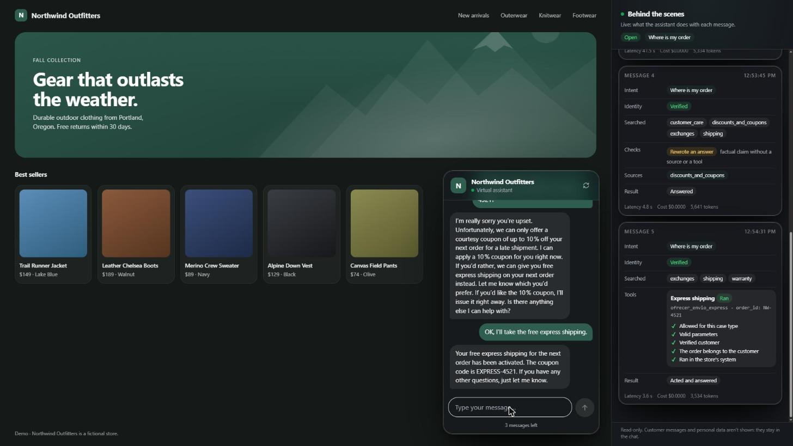
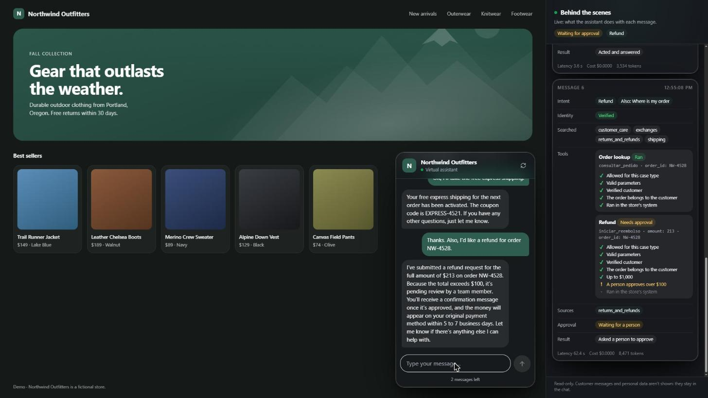
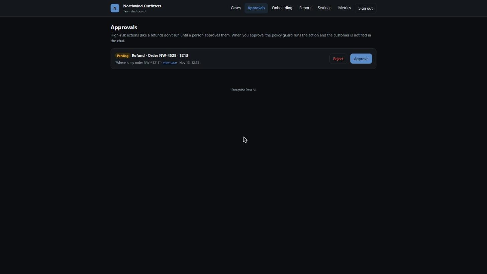
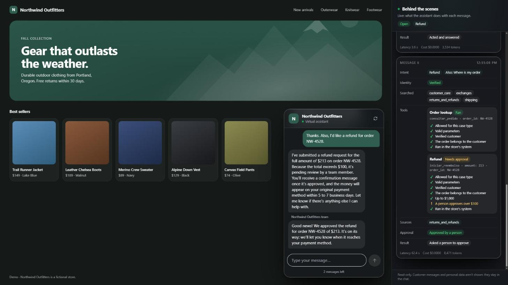

# Guion del video de la demo en inglés (90 segundos)

El video muestra a **Northwind Outfitters**, una tienda ficticia de ropa outdoor. A la izquierda están su sitio y su chat; a la derecha, la vista **"detrás de escena"**, con lo que hace el asistente en cada mensaje (decisión 041).

La historia: una clienta con un pedido atrasado se enoja, pide un descuento fuera de la política, elige la alternativa y pide un reembolso grande, que aprueba una persona. Todo es de demo: emails `@example.com` y teléfonos 555-01xx.

Probado de punta a punta en Chrome el 13 de noviembre de 2026, con el modelo de siempre (`openai/gpt-oss-20b` en Groq). Las capturas están en `docs/img/demo-en/`.

## Antes de grabar

1. **Base y Northwind:** `make demo-setup`. Crea o regenera Acme y Northwind, con la vista "detrás de escena" activada.
   - La clave del panel de Northwind sale de `NORTHWIND_PASSWORD` en `.env`. El usuario es `demo@northwind.example`.
2. **Límite del chat:** en `.env`, `WEB_CHAT_IP_DAILY_LIMIT=200`.
   - El chat permite 30 mensajes por IP cada 24 horas, y un ensayo completo usa 6.
   - Si queda poco, el widget muestra "N messages left". Al llegar a cero, no responde más hasta el día siguiente.
3. **API:** `make api`. Dejá la terminal a la vista, pero fuera de cuadro: de ahí sale el código de verificación. Buscá la línea `[Mailer de consola, no se envió]`; el email `@example.com` no existe.
4. **Panel:** en una pestaña, `http://localhost:8000/panel`, con el usuario de Northwind.
   - Casos → **Reset demo**: archiva las conversaciones de prueba y devuelve los pedidos a su estado inicial.
5. **La página del video:** en otra pestaña, `http://localhost:8000/demo/northwind-outfitters`.
   - Tocá el botón de las dos flechas del chat y después **"Yes, start over"**. El panel de la derecha queda en "Write in the chat to see each step here".
6. **Ventana:** 1456×819 o más ancha (las capturas son de 1456×819), con el zoom del navegador al 100 %. El modo oscuro del sistema da el aspecto de las capturas.
7. **Ensayá una vez entera:** la primera respuesta del modelo del día suele tardar más.

**Se graba en tiempo real y se edita.** Con el nivel gratuito de Groq cada respuesta tarda entre 5 y 80 segundos: casi todo es la espera del límite de tokens por minuto. En la edición se cortan las esperas (los tres puntos del chat) y quedan los 90 segundos.

**No escribas mientras el asistente responde:** el chat ignora Enter hasta que llega la respuesta (la flecha de enviar está apagada). Esperá a ver la respuesta completa y al panel actualizado. El panel se actualiza cuando termina cada respuesta, no durante.

## El guion

Los tiempos son del video ya editado. Lo que se escribe va en inglés, tal cual.

### 0:00–0:08 · Presentación

**Qué se ve:** la página entera. A la izquierda, el sitio de Northwind con el chat abierto; a la derecha, "Behind the scenes" vacío.

**Texto en pantalla o voz:** *"An AI support agent that learned this store's policies, works with its order system and shows every step it takes."*

### 0:08–0:28 · Un pedido atrasado, con verificación

1. Tocá la sugerencia **"Where is my order NW-4521?"**.
   - El asistente pide el email de la compra: no da datos de un pedido sin verificar al titular.
2. Escribí `emily@example.com`. Responde que mandó un código.
3. Copiá el código de 6 dígitos de la terminal y escribilo.
4. **La respuesta:**
   - el pedido está demorado por clima en Denver;
   - la nueva fecha es el 14 de noviembre;
   - ofrece dos opciones: un cupón de hasta 10 % o envío express gratis.

**Qué mostrar en el panel:** el mensaje 3 completo.

- **Intent:** Where is my order.
- **Identity:** Verified.
- **Order lookup** con sus reglas en verde: verified customer, the order belongs to the customer, ran in the store's system.

**Qué decir:** *"It verifies the customer first, then checks the real order — and offers the options the policy allows."*

### 0:28–0:45 · Cliente molesta, pedido fuera de la política

Escribí: **`Honestly, that's frustrating. Can you give me a 25% coupon for order NW-4521?`**

**La respuesta:**

- empieza con empatía ("I'm really sorry you're upset");
- explica que el tope es 10 %;
- vuelve a ofrecer el cupón del 10 % o el envío express.

**Qué mostrar en el panel:**

- **Sources:** `discounts_and_coupons`. La negativa sale de la política, no del modelo.
- **Checks**, si aparece "Rewrote an answer": el control de fundamento rechazó una respuesta sin fuente y el asistente la rehízo.

**Qué decir:** *"It can't be talked into breaking policy: the 10% cap is enforced in code by the policy guard, not by the prompt."*

### 0:45–0:55 · Elige la alternativa: el asistente actúa

Escribí: **`OK, I'll take the free express shipping.`**

**La respuesta:** listo, con el código `EXPRESS-4521`.

**Qué mostrar en el panel:**

- la herramienta **Express shipping** (`ofrecer_envio_express`, `order_id: NW-4521`), con todas las reglas en verde;
- **Result:** Acted and answered.

**Qué decir:** *"Low-risk actions it simply does — through the same guard, and fully audited."*

### 0:55–1:10 · Un reembolso grande: decide una persona

Escribí: **`Thanks. Also, I'd like a refund for order NW-4528.`**

**La respuesta:** inició el reembolso de USD 213 y queda en revisión de una persona, porque supera los USD 100.

**Qué mostrar en el panel:**

- la herramienta **Refund** (`amount: 213`) con la regla **"A person approves over $100"** en ámbar;
- **Approval:** Waiting for a person;
- arriba, el caso en **Waiting for approval**.

**Qué decir:** *"Money over $100 always goes to a person. No prompt can change that."*

### 1:10–1:22 · La persona aprueba desde el panel

1. Pasá a la pestaña del panel → **Approvals**. Está "Refund · Order NW-4528 · $213".

   

2. Tocá **Approve**.
3. Volvé a la página de la demo. En unos segundos:
   - en el chat aparece el mensaje del **Northwind Outfitters team**: "Good news! We approved the refund…";
   - en el panel, **Approval: Approved by a person** y la regla "Ran in the store's system" en verde.

### 1:22–1:30 · Cierre

**Qué mostrar:** el panel completo, bajando por los mensajes. En cada uno se ven la latencia, el costo y los tokens.

**Texto en pantalla o voz:** *"Every step is verified, guarded and audited — and it costs cents per conversation."* Con Groq gratuito el panel muestra `$0.0000`; con Claude muestra el costo real de cada mensaje.

## Si algo sale distinto

- **El asistente respondió el 25 % sin llamar a la herramienta del cupón.** Es lo más común: lee la política de descuentos y no intenta el 25 %. Si llama a la herramienta, el guardián la frena. El panel muestra entonces **Coupon** con ✕ en "Up to 10%" y "Offered instead: Coupon (up to 10%) · Express shipping". Las dos variantes sirven para el video.
- **"I'm passing you to a member of our team"** en lugar de una respuesta: el modelo falló dos veces el control de fundamento o de conducta. El panel muestra el motivo en **Checks**. Reiniciá la demo (paso 4 y 5 de "Antes de grabar") y repetí. Pasó en las pruebas antes de los arreglos de la tarea 5 y no volvió a pasar en las últimas dos corridas completas.
- **"We couldn't reach the assistant" o "We ran into a problem":** se agotó la cuota de Groq o el límite de mensajes. Esperá un minuto o revisá `WEB_CHAT_IP_DAILY_LIMIT`.
- **El código no aparece en la terminal:** buscá `[Mailer de consola` en la salida de `make api`. Vence a los 10 minutos.
- **El panel de la derecha da 404 o queda vacío:** la vista está apagada (Panel → Settings → Behind the scenes → Activate), o el chat se abrió en otra pestaña con otra sesión. Usá el chat de la misma página.
- **Los pedidos ya tienen el envío express o el reembolso de un ensayo anterior:** Reset demo en el panel. Devuelve los pedidos a su estado inicial.
