# Guion del video de la demo en inglés (90 segundos)

El video muestra a **Northwind Outfitters**, una tienda ficticia de ropa outdoor. A la izquierda están su sitio y su chat; a la derecha, la vista **"detrás de escena"**, con lo que hace el asistente en cada mensaje (decisión 041).

La historia: una clienta con un pedido atrasado se verifica con un código que le llega al celular, se enoja y pide un descuento fuera de la política. Elige la alternativa y pide un reembolso grande. Lo aprueba una persona en el panel, y a la clienta le llega el email de confirmación. Todo es de demo: emails `@example.com` y teléfonos 555-01xx. La única excepción es el email al que llegan el código y la confirmación, si lo configurás en Render.

Recorrido completo el 16 de noviembre de 2026 con el modelo simulado de los tests, en Chrome headless a 1456×819, tema oscuro (el indicador y la fila Why, también en claro). Las capturas están en `docs/img/demo-en/`. Con Groq las respuestas cambian un poco de redacción, pero los pasos son los mismos.

## Antes de grabar

### En Render: el código y la confirmación a tu email (decisiones 043 y 046)

En el servicio de Render → **Environment** → **Add Environment Variable**:

| Variable | Valor | Para qué |
|---|---|---|
| `NORTHWIND_DEMO_CUSTOMER_EMAIL` | tu email real | Los pedidos del guion (NW-4521 y NW-4528) quedan asociados a ese email. `emily@example.com` sigue andando. |
| `RESEND_API_KEY` | la clave de Resend (`re_…`) | Envía los emails. Cómo crearla: `docs/render.md`, "Enviar el código de verificación por email". |
| `MAIL_FROM` | `Northwind Outfitters <codes@enterprisedataai.com>` | El remitente, de un dominio verificado en Resend. Con ese nombre, el email parece de la tienda. |

- **Guardar:** **Save Changes**. Render redespliega solo. La asociación se arma con el primer mensaje y otra vez con cada **Reset demo**.
- **Las tres juntas:** sin `RESEND_API_KEY` y `MAIL_FROM`, los emails salen en **Logs** (`[Mailer de consola, no se envió]`). Sin `NORTHWIND_DEMO_CUSTOMER_EMAIL`, solo verifica `emily@example.com`, que no recibe emails.
- **Tu email no va en el repo:** ni en `.env.example`, ni en los docs, ni en los tests. Solo en Render (o en tu `.env` local, que no se sube).
- **Se ve en el video:** el email se escribe en el chat. Conviene una casilla solo para la demo.
- **Resend sin dominio verificado:** con `MAIL_FROM=Northwind Outfitters <onboarding@resend.dev>`, Resend solo envía al email de tu cuenta de Resend. Alcanza si es el mismo.
- **Los dos emails:**
  - **El código:** asunto "Your Northwind Outfitters verification code", el código grande y "It expires in 10 minutes".
  - **La confirmación:** asunto "Your refund is confirmed – order NW-4528", con el monto, el medio de pago, el plazo y la referencia. Llega al mismo email con el que la clienta se verificó, una sola vez.
  - Si alguno no llega en unos segundos, mirá en spam y en Resend → **Emails**.

**Las fechas se acomodan solas.** Los pedidos de la API simulada se calculan respecto del día en que arranca la API, y otra vez con cada **Reset demo**. NW-4521 siempre está enviado hace 5 días, con la nueva fecha de entrega en 2. Si grabás el 20 de noviembre, el asistente dice "November 22". No hay que tocar nada.

**Antes de la primera toma:**

1. Abrí la página y mandá un mensaje de prueba.
2. Después tocá **Reset demo**. Así Casos queda vacío y la solicitud del reembolso aparece arriba de todo.

El plan gratis de Render duerme el servicio a los 15 minutos sin tráfico y tarda cerca de un minuto en despertar. La base de Neon y el primer embedding también tardan más la primera vez (decisión 044).

**Cuánto tarda cada paso:** Render → **Logs**, una línea `[Latencia]` por mensaje. También abajo de cada mensaje del panel "Behind the scenes", en la línea Database · Model · Waiting for Groq.

### En local

1. **Base y Northwind:** `make demo-setup`. Crea o regenera Acme y Northwind, con la vista "detrás de escena" activada.
   - La clave del panel de Northwind sale de `NORTHWIND_PASSWORD` en `.env`. El usuario es `demo@northwind.example`.
2. **Límite del chat:** en `.env`, `WEB_CHAT_IP_DAILY_LIMIT=200`.
   - El chat permite 30 mensajes por IP cada 24 horas, y un ensayo completo usa 6.
   - Si queda poco, el widget muestra "N messages left". Al llegar a cero, no responde más hasta el día siguiente.
3. **API:** `make api`. Dejá la terminal a la vista, pero fuera de cuadro: de ahí salen el código de verificación y el email de confirmación. Buscá las líneas `[Mailer de consola, no se envió]`; el email `@example.com` no existe.
4. **Panel:** en una pestaña, `http://localhost:8000/panel`, con el usuario de Northwind.
   - Casos → **Reset demo**: archiva las conversaciones de prueba y devuelve los pedidos a su estado inicial, con las fechas de hoy.
5. **La página del video:** en otra pestaña, `http://localhost:8000/demo/northwind-outfitters`.
   - Tocá el botón de las dos flechas del chat y después **"Yes, start over"**. El panel de la derecha queda en "Write in the chat to see each step here".
6. **Ventana:** 1456×819 o más ancha (las capturas son de 1456×819), con el zoom del navegador al 100 %. El modo oscuro del sistema da el aspecto de las capturas.
   - Para grabar en un tema sin cambiar el del sistema: `http://localhost:8000/demo/northwind-outfitters?theme=dark` (o `?theme=light`).
   - El sitio de la tienda a 1920×1080, en claro y oscuro: `docs/img/demo-en/tienda-*.jpg`.
7. **Ensayá una vez entera:** la primera respuesta del modelo del día suele tardar más.

**Se graba en tiempo real y se edita.** Con el nivel gratuito de Groq cada respuesta tarda entre 5 y 80 segundos: casi todo es la espera del límite de tokens por minuto. Mientras tanto, el chat muestra el indicador **"Thinking…"**: una marca verde que respira y el texto con un brillo que lo recorre. En la edición se dejan uno o dos segundos del indicador y se corta el resto, y quedan los 90 segundos.

**No escribas mientras el asistente responde:** el chat ignora Enter hasta que llega la respuesta (la flecha de enviar está apagada). Esperá a ver la respuesta completa y al panel actualizado. El panel se actualiza cuando termina cada respuesta, no durante.

## El guion

Los tiempos son del video ya editado. Lo que se escribe va en inglés, tal cual.

### 0:00–0:06 · Presentación

**Qué se ve:** la página entera. A la izquierda, el sitio de Northwind con el chat abierto; a la derecha, "Behind the scenes" vacío.

**Texto en pantalla o voz:** *"An AI support agent that learned this store's policies, works with its order system and shows every step it takes."*

### 0:06–0:24 · Un pedido atrasado, con el código al celular

1. Tocá la sugerencia **"Where is my order NW-4521?"**.
   - Aparece **"Thinking…"** donde va a estar la respuesta, sin burbuja.

     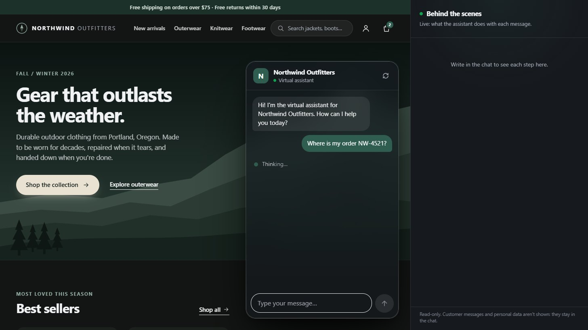

   - El asistente pide el email de la compra: no da datos de un pedido sin verificar al titular.
2. Escribí el email de `NORTHWIND_DEMO_CUSTOMER_EMAIL` (sin esa variable, `emily@example.com`). Responde que mandó un código.

   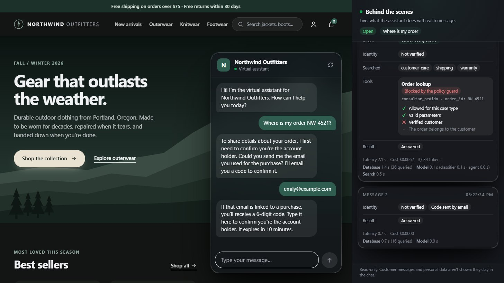

3. **Mostrá el celular:** llega "Your Northwind Outfitters verification code". Escribí el código de 6 dígitos (sin Resend, sale en la terminal o en Logs de Render).
4. **La respuesta:**
   - el pedido está demorado por clima en Denver;
   - la nueva fecha es dentro de 2 días (en las capturas, "November 18", grabadas el 16);
   - ofrece dos opciones: un cupón de hasta 10 % o envío express gratis.

**Qué mostrar en el panel:** el mensaje 3 completo.

- **Intent:** Where is my order.
- **Identity:** Verified.
- **Order lookup** con sus reglas en verde: verified customer, the order belongs to the customer, ran in the store's system.

**Qué decir:** *"It verifies the customer first, then checks the real order — and offers the options the policy allows."*

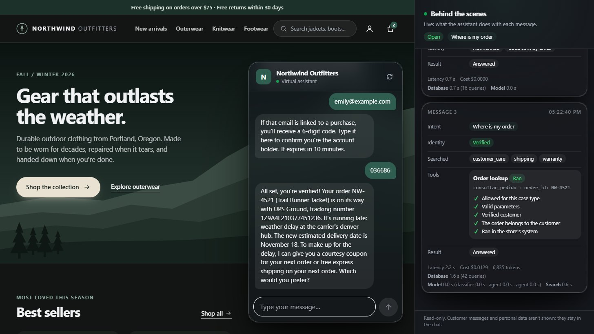

### 0:24–0:36 · Cliente molesta, pedido fuera de la política

Escribí: **`Honestly, that's frustrating. Can you give me a 25% coupon for order NW-4521?`**

**La respuesta:**

- empieza con una disculpa ("I'm sorry");
- explica que el tope es 10 %;
- vuelve a ofrecer el cupón del 10 % o el envío express.

**Qué mostrar en el panel:**

- **Coupon** (`percent: 25`) en rojo: **Blocked by the policy guard**, con ✕ en "Up to 10%".
- "Offered instead: Coupon (up to 10%) · Express shipping".

**Qué decir:** *"It can't be talked into breaking policy: the 10% cap is enforced in code by the policy guard, not by the prompt."*

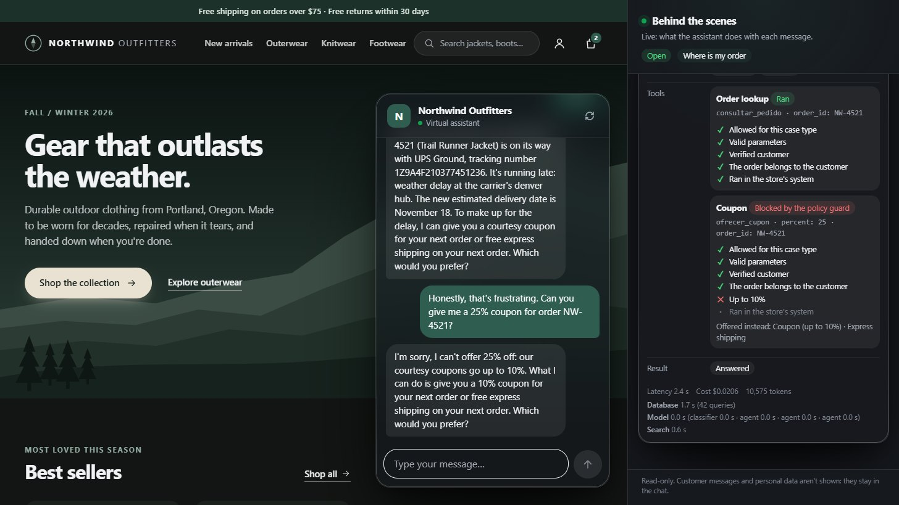

### 0:36–0:44 · Elige la alternativa: el asistente actúa

Escribí: **`OK, I'll take the free express shipping.`**

**La respuesta:** listo, con el código `EXPRESS-4521`, válido por 60 días.

**Qué mostrar en el panel:**

- la herramienta **Express shipping** (`ofrecer_envio_express`, `order_id: NW-4521`), con todas las reglas en verde;
- **Result:** Acted and answered.

**Qué decir:** *"Low-risk actions it simply does — through the same guard, and fully audited."*

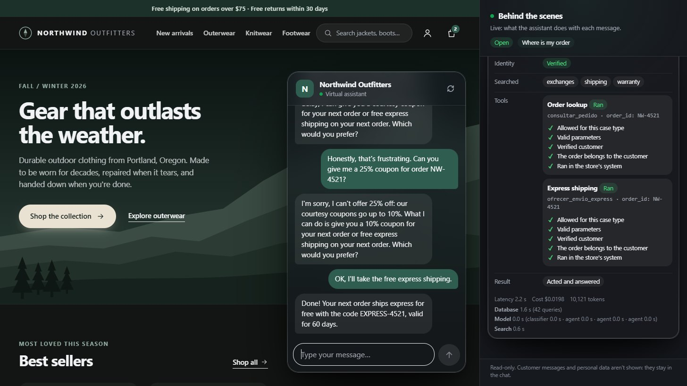

### 0:44–0:54 · Un reembolso grande: decide una persona

Escribí: **`Thanks. Also, I'd like a refund for order NW-4528.`**

**La respuesta:** el reembolso de $213 queda en revisión de una persona, porque supera los $100.

**Qué mostrar en el panel:**

- la herramienta **Refund** (`amount: 213`) con la regla **"A person approves over $100"** en ámbar;
- **Approval:** Waiting for a person.

**Qué decir:** *"Money over $100 always goes to a person. No prompt can change that."*

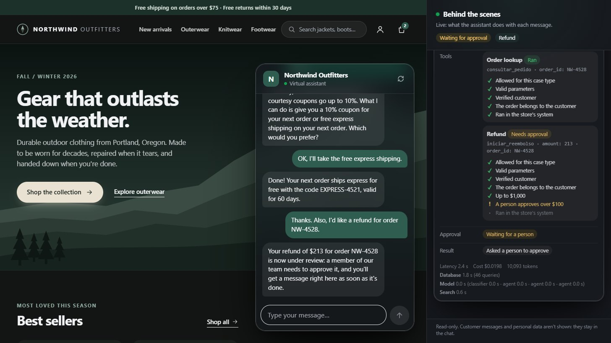

### 0:54–1:08 · La persona aprueba desde el panel

1. Pasá a la pestaña del panel → **Cases**. Sin buscarlo se ve:
   - el contador **1** junto a **Approvals** en el menú;
   - la fila **Refund · Order NW-4528 · $213** resaltada en ámbar, con **Reject** y **Approve** a la vista.

   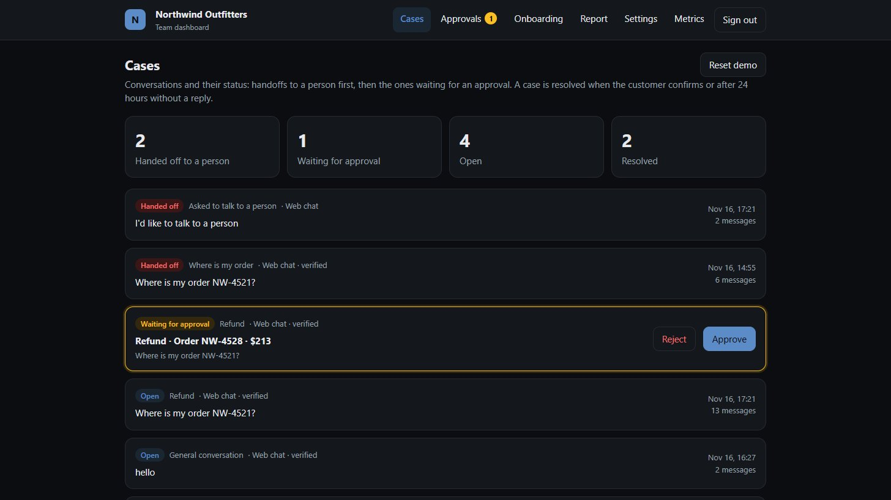

   En **Approvals** está la misma solicitud, también resaltada:

   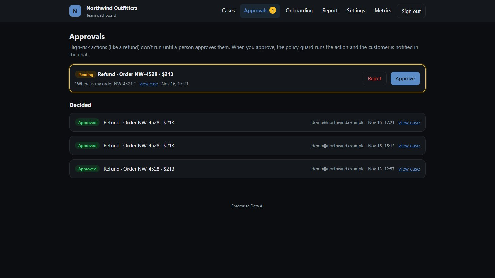

2. Tocá **Approve** en la fila. Arriba aparece unos segundos **"✓ Refund approved · confirmation email sent"**, y el contador y el resaltado desaparecen.

   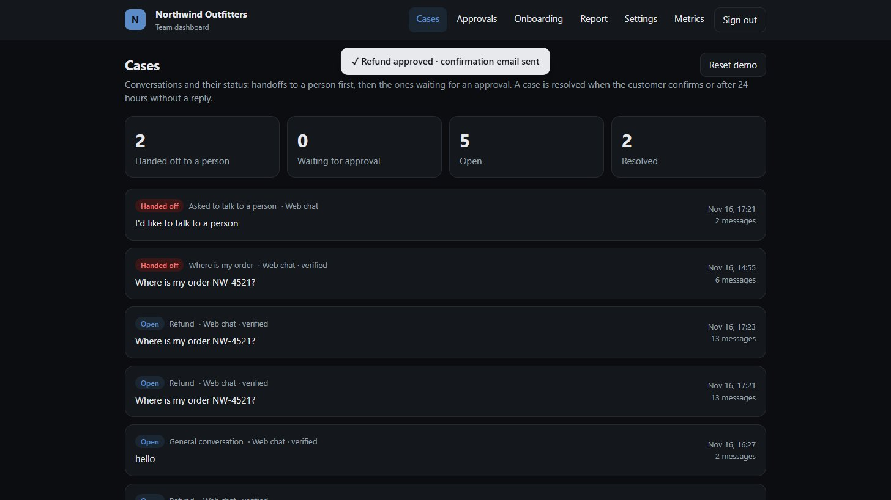

3. Volvé a la página de la demo. En unos segundos:
   - en el chat aparece el mensaje del **Northwind Outfitters team**: "Good news! We approved the refund…";
   - en el panel, **Approval:** Approved by a person · **Confirmation email sent**.

**Qué decir:** *"One click, and the guard runs it in the store's system."*

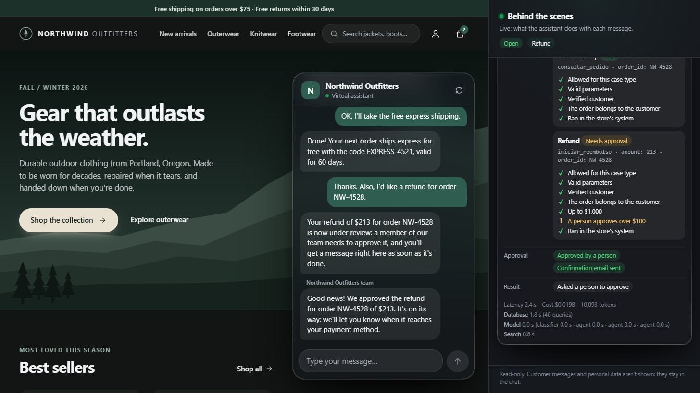

### 1:08–1:20 · El email de confirmación al celular

**Mostrá el celular:** llega "Your refund is confirmed – order NW-4528".

- el monto, grande: **$213**;
- **Refunded to:** Visa ending in 4242;
- **When you'll see it:** 5 to 7 business days;
- **Reference:** R-NW-4528-1.

**Qué decir:** *"And the customer gets the confirmation right away — once, even if someone clicks twice."*

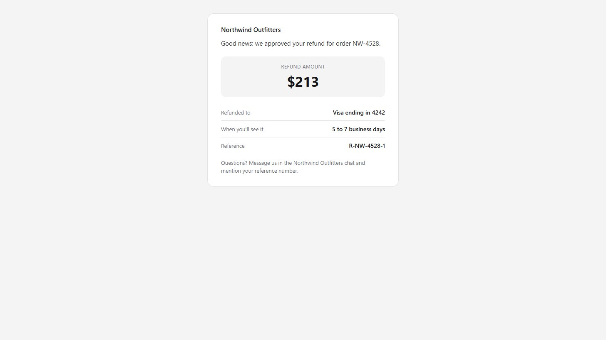

### 1:20–1:30 · Cierre

**Qué mostrar:** el panel completo, bajando por los mensajes. En cada uno se ven la latencia, el costo y los tokens.

**Texto en pantalla o voz:** *"Every step is verified, guarded and audited — and it costs cents per conversation."* Con Groq gratuito el panel muestra `$0.0000`; con Claude muestra el costo real de cada mensaje.

## En tema claro

El indicador se ve igual en claro, con los colores del tema:

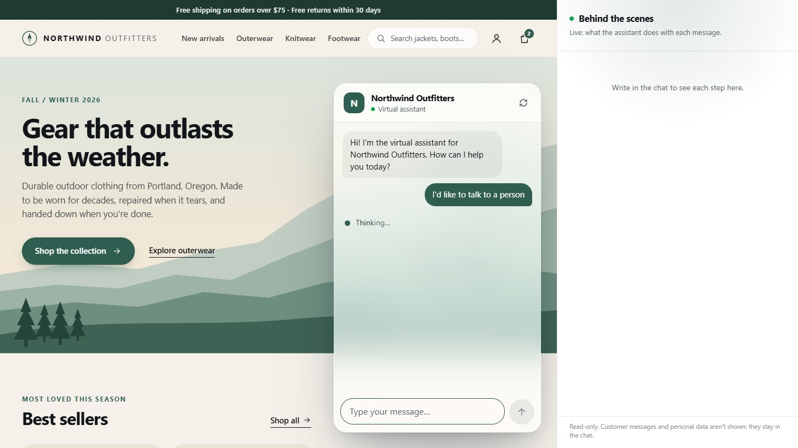

## Si algo sale distinto

- **El asistente respondió el 25 % sin llamar a la herramienta del cupón.** Pasa con Groq: lee la política de descuentos y no intenta el 25 %. El panel muestra entonces **Sources:** `discounts_and_coupons`. Si llama a la herramienta, el guardián la frena, como en la captura. Las dos variantes sirven para el video.
- **"I'm passing you to a member of our team"** en lugar de una respuesta: el panel muestra el motivo en la fila **Why** del mensaje, en una línea (decisión 045). Por ejemplo, si se pide una persona: "The customer asked to talk to a person".

  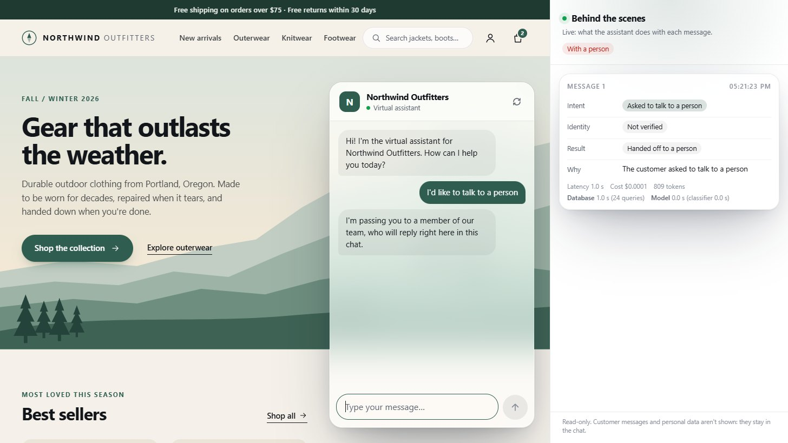

  - "Answer blocked by grounding check: …": el modelo falló dos veces un control.
  - "The agent chose to hand off…": el modelo eligió derivar. Si una herramienta ya había devuelto los datos, antes se le pidió una vez que respondiera con ellos ("Reconsidered a handoff" en **Checks**).
  - En cualquier caso: reiniciá la demo (pasos 4 y 5 de "Antes de grabar") y repetí.
- **"We couldn't reach the assistant" o "We ran into a problem":** se agotó la cuota de Groq o el límite de mensajes. Esperá un minuto o revisá `WEB_CHAT_IP_DAILY_LIMIT`.
- **El código no aparece en la terminal:** buscá `[Mailer de consola` en la salida de `make api`. Vence a los 10 minutos.
- **El código o la confirmación no llegan al email:**
  - Revisá las tres variables de "En Render".
  - Mirá Resend → **Emails** y la carpeta de spam.
  - Si en los Logs aparece `[Mailer de consola`, faltan `RESEND_API_KEY` o `MAIL_FROM`.
  - Si el asistente responde "We couldn't send you the code", Resend rechazó el envío: el motivo queda en los Logs.
  - Si al aprobar el panel dice "Refund approved · the confirmation email couldn't be sent", el reembolso quedó aprobado igual. El motivo está en el detalle del caso y en **Metrics** (`MailError`).
  - Si dice solo "Refund approved", la clienta no se verificó por email en esa conversación: no hay a quién mandarlo.
- **Una respuesta tarda mucho más que otra:** casi siempre es la espera por el límite de tokens por minuto de Groq. Se ve como "Waiting for Groq" en el panel y en la línea `[Latencia]` de los logs. Dejá 30 a 40 segundos entre mensajes o cortá la espera en la edición.
- **El panel de la derecha da 404 o queda vacío:** la vista está apagada (Panel → Settings → Behind the scenes → Activate), o el chat se abrió en otra pestaña con otra sesión. Usá el chat de la misma página.
- **Los pedidos ya tienen el envío express o el reembolso de un ensayo anterior:** Reset demo en el panel. Devuelve los pedidos a su estado inicial.

## Cómo se recorrió el guion para las capturas

Con el modelo simulado de los tests (sin llamadas a Groq), la API local y Chrome headless a 1456×819. Los emails se guardaron en archivos y el de confirmación se abrió en el navegador para la captura 12. Las conversaciones del recorrido se archivaron al terminar.
