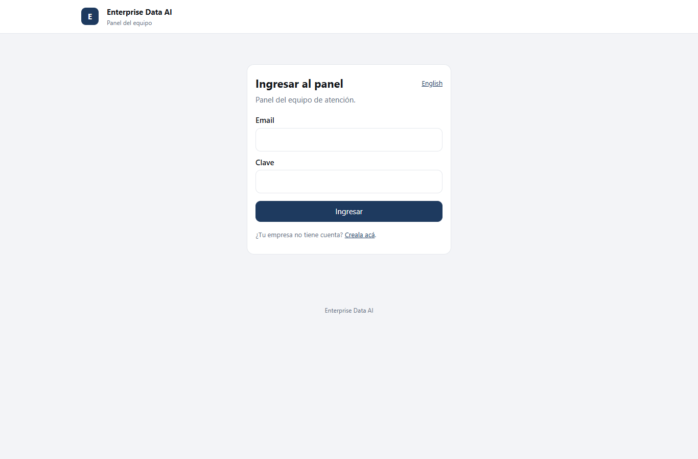
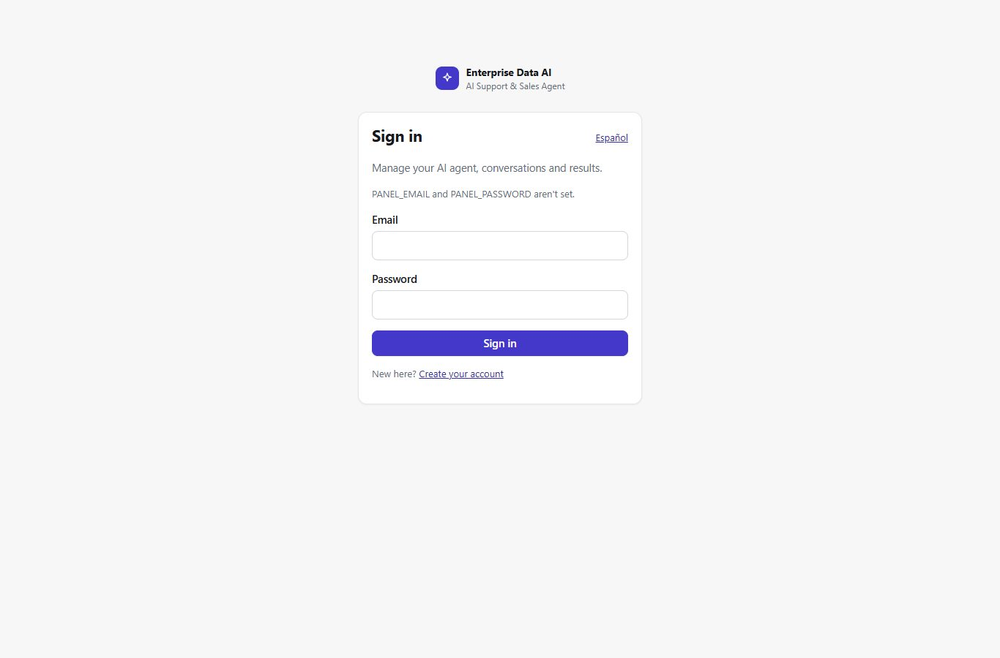
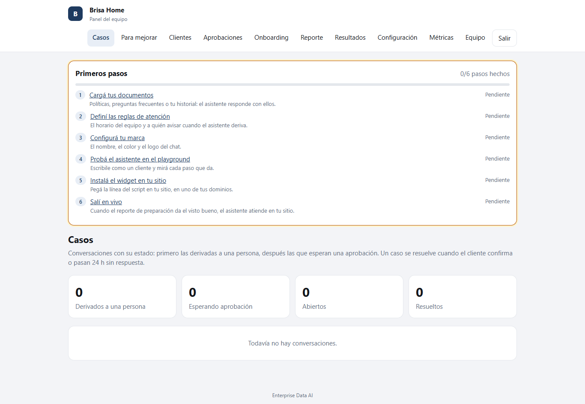
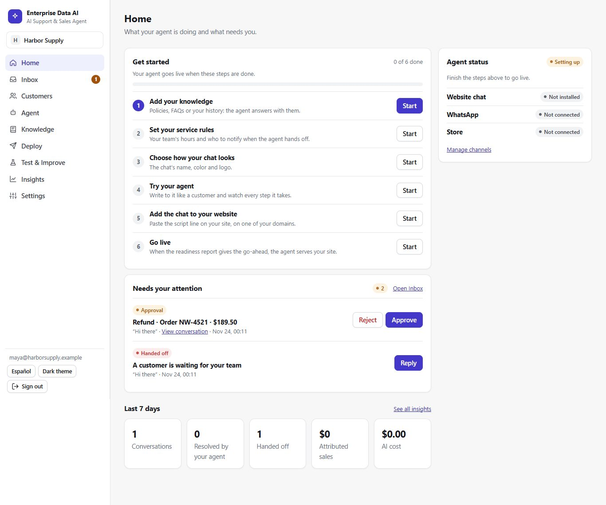
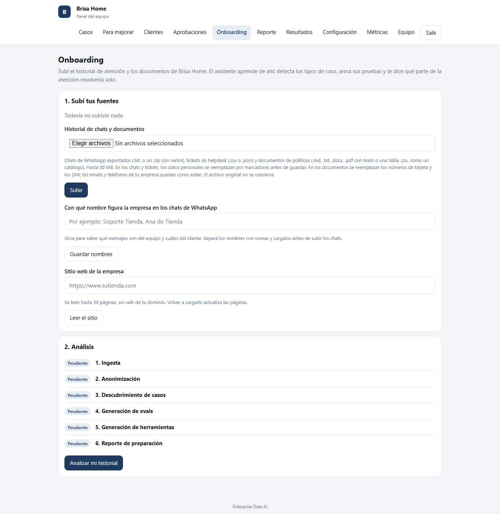
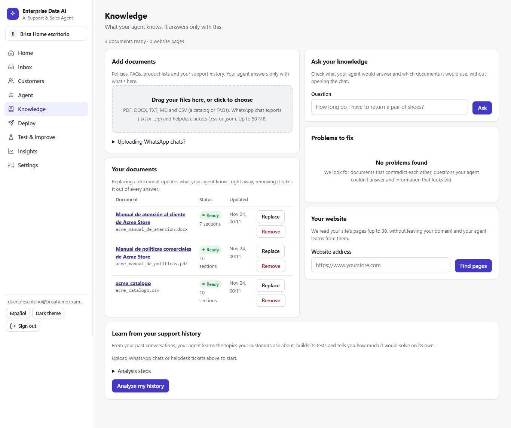
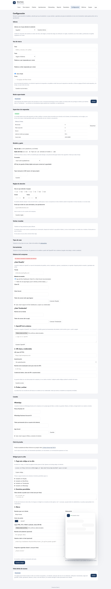
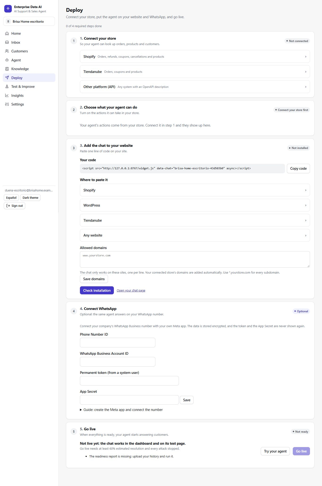
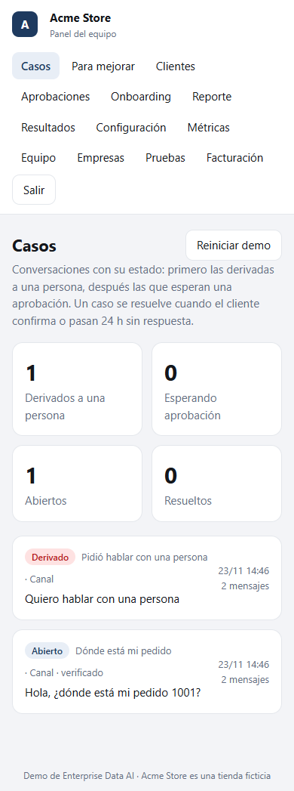
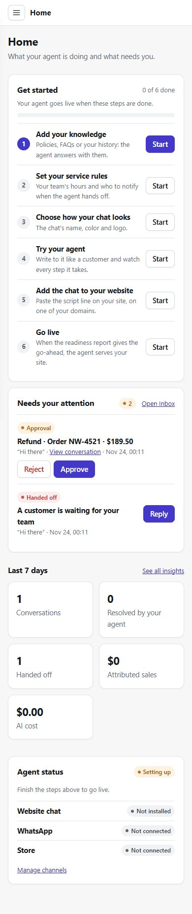

# El panel, rediseñado desde los ojos del cliente (Hito 13)

Qué cambió en el panel y por qué. Las capturas salen de un recorrido headless como un cliente nuevo: registro, Home, Knowledge, Deploy, Agent, Test, Inbox e Insights. Lo genera `python evals/panel_tour.py` (necesita Playwright aparte; ver el script). Las de **antes** son de `main` antes del Hito 13: [docs/img/panel/antes](img/panel/antes). Las de **después**: [docs/img/panel/despues](img/panel/despues). Todas están en computadora y en celular.

## Antes y después

| | Antes | Después |
|---|---|---|
| Entrada |  |  |
| Lo primero que se ve |  |  |
| El conocimiento |  |  |
| Configurar y publicar |  |  |
| En el celular |  |  |

## Qué cambió y por qué

**1. Identidad y navegación** (decisión 085)
- **Antes:**
  - el título era el nombre de la empresa con "Panel del equipo";
  - una barra con 13 links que en el celular ocupaba media pantalla;
  - avisos de demo para todos.
- **Ahora:** "Enterprise Data AI · AI Support & Sales Agent", con la empresa como etiqueta, y una barra lateral con 9 secciones en el orden en que se usan: Home, Inbox, Customers, Agent, Knowledge, Deploy, Test & Improve, Insights y Settings. Cada sección tiene sus pestañas.
- La zona del operador (Companies, Trials, Billing y Behind the scenes) va aparte y un cliente no la ve.
- **Por qué:** el cliente compra un producto, no un panel de la demo. Cada cosa tiene que estar donde la busca.

**2. Idioma** (decisión 085)
- **Antes:** en español, o en inglés si la empresa era en inglés, con jerga interna: guardián, tipos de caso, herramientas, evals, onboarding, asistente.
- **Ahora:** inglés por defecto, y cada usuario elige English o Español. El vocabulario es del cliente: agent, actions, topics, knowledge, tests.
- **Por qué:** el producto se vende afuera y quien lo usa no tiene que aprender nuestras palabras.

**3. Home**
- **Antes:** se entraba a Casos.
- **Ahora** Home muestra:
  - los primeros pasos hasta salir en vivo, empezando por el conocimiento;
  - lo que te necesita (aprobaciones, derivaciones y borradores), con un clic para resolverlo;
  - los números de la semana;
  - el estado del agente y de cada canal.
- **Por qué:** al entrar, el cliente quiere saber si hay algo urgente y qué le falta.

**4. Deploy** (decisión 086)
- **Antes:** la conexión con la tienda, el widget y WhatsApp estaban en partes de una página de 7000 px, y salir en vivo en otra.
- **Ahora:** una pantalla con cinco pasos y su estado:
  1. Conectar la tienda. Conectar prueba la conexión en el momento y dice qué falta (un permiso, una credencial o la tienda) y qué hacer.
  2. Elegir las acciones.
  3. Instalar el chat. Los dominios de la tienda se agregan solos, las guías están verificadas y Check installation confirma que cargó.
  4. WhatsApp.
  5. Salir en vivo.
- **Por qué:** es la tarea más técnica del cliente, y tiene que poder hacerla solo.

**5. Agent** (decisión 087)
- **Antes:** opciones sin explicación en una página larga.
- **Ahora:**
  - seis pestañas;
  - cada opción con una línea de ayuda y un ejemplo;
  - la marca y la voz con una vista previa del chat real que cambia al escribir;
  - un aviso "Saved" al guardar.
- **Por qué:** configurar sin miedo; lo que se cambia, se ve antes de que lo vea un cliente.

**6. Knowledge** (decisión 088)
- **Antes:** subir archivos y analizar el historial, sin ver qué había aprendido. Un archivo que fallaba solo dejaba un aviso.
- **Ahora**, sin perder nada de Onboarding:
  - subir arrastrando, con el estado de cada archivo;
  - qué aprendió de cada documento;
  - reemplazar y borrar;
  - Ask your knowledge, con las fuentes;
  - los problemas para arreglar;
  - el sitio con sus páginas y sincronización semanal.

  La extracción conserva títulos, listas y tablas, y los fragmentos no cortan una política: medido en [calidad.md](calidad.md).
- **Por qué:** el agente responde solo con esto, y el cliente tiene que poder confiar en lo que sabe.

**7. Sistema de diseño** (decisión 089)
- Un solo juego de colores, tipografía y componentes.
- Tema claro y oscuro.
- Confirmación antes de lo peligroso.
- Estados vacíos que explican y ofrecen qué hacer.
- Accesible: un título por pantalla, cada control con su etiqueta y foco visible.
- En Insights, lo técnico (latencias, proveedores, trazas, pruebas) queda para el operador.

## Lo que encontró el recorrido

El recorrido headless hizo lo que no hacen los tests: correr el JavaScript en un navegador. Encontró dos cosas, ya arregladas y con su test:

- **Subir arrastrando no arrancaba.** Los textos para JavaScript iban escapados como HTML dentro de un `<script type="application/json">`, y `JSON.parse` fallaba.
- **"Problems to fix" mostraba contradicciones falsas.** Un plazo que estaba lejos del tema ("10 días hábiles para responder… y el reembolso") contaba como plazo de devolución. Ahora el plazo tiene que estar pegado al tema, y los plazos de entrega, que dependen de la zona, no se comparan.

## Qué queda

- Probar con usuarios reales: la claridad se mide mirando a alguien usarlo.
- Un app embed de Shopify cuando exista la app de la plataforma (decisión 086).
- Correr `evals/shopify_e2e.py` contra una tienda de desarrollo real.
