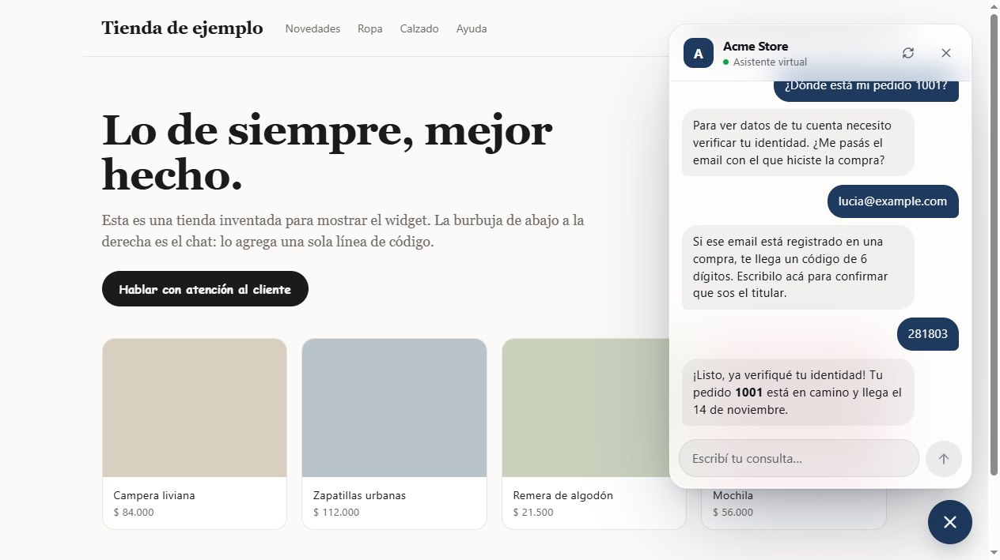
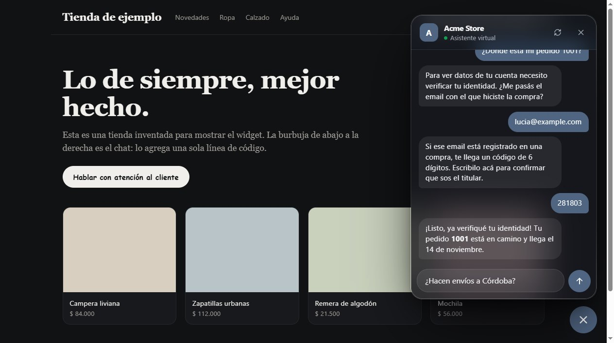
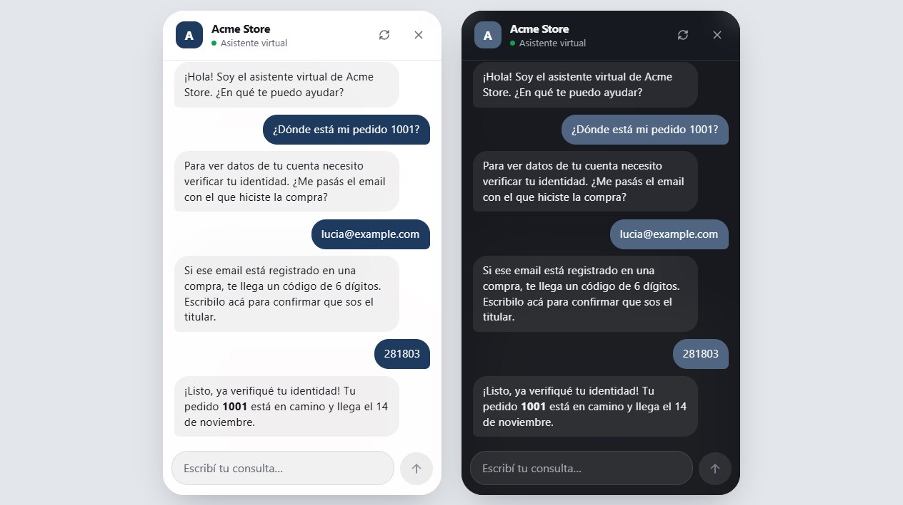
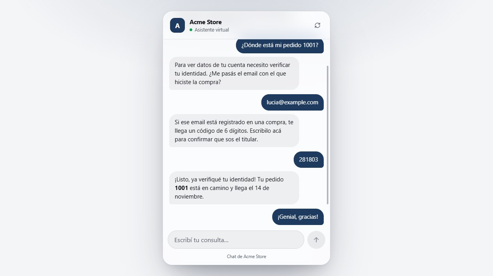
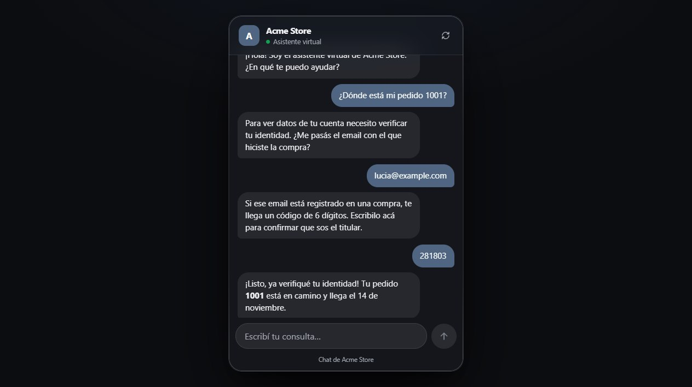

# Widget para el sitio del cliente

El chat de una empresa, en su propio sitio, con una línea de código. Decisión 031.

| Escritorio, claro | Escritorio, oscuro |
|---|---|
|  |  |



La página propia del chat (`/c/<enlace>`) usa el mismo widget:

| Página, claro | Página, oscuro |
|---|---|
|  |  |

## Instalarlo

1. Entrá al panel → **Configuración** → **Widget para tu sitio**.
2. En **Dominios permitidos**, cargá el sitio donde va el chat. Uno por línea.
   - `www.tutienda.com`: ese sitio.
   - `*.tutienda.com`: todos sus subdominios.
   - `localhost`: para probar en tu computadora.
3. Tocá **Copiar código** y pegalo antes de `</body>`, en todas las páginas donde quieras el chat:

   ```html
   <script src="https://TU-SERVICIO/widget.js" data-chat="ENLACE-DE-TU-CHAT" async></script>
   ```

4. Recargá tu sitio. Aparece una burbuja abajo a la derecha.

Si la burbuja no aparece, abrí la consola del navegador. Si dice que el dominio no está en la lista, falta el paso 2.

## Marca

En la misma pantalla:

- **Nombre** que ve el cliente.
- **Color de acento:** uno solo. El widget ajusta el contraste solo.
- **Logo:** PNG, JPG o WebP, cuadrado, de hasta 200 KB. Sin logo se muestra la inicial.
- **Preguntas sugeridas:** hasta 4. Aparecen cuando la conversación está vacía.

La vista previa de la derecha es el chat real: cada cambio se ve antes de guardar.

## Opciones

Atributos de la etiqueta `<script>`:

| Atributo | Para qué |
|---|---|
| `data-chat` | El enlace del chat de la empresa. Lo da el panel. |
| `data-theme` | `light` o `dark`. Por defecto sigue al sitio o al sistema. |
| `data-position` | `left` para la burbuja a la izquierda. |

Desde el sitio se puede abrir el chat con un botón propio:

```html
<button onclick="EnterpriseChat.open()">Hablar con atención al cliente</button>
```

También hay `EnterpriseChat.close()` y `EnterpriseChat.toggle()`.

## Página de ejemplo

`docs/widget-ejemplo.html` es un sitio inventado con el widget instalado.

```bash
make api                                        # el chat, en http://localhost:8000
python -m http.server 8010 --directory docs     # el sitio de ejemplo
```

1. En el panel → **Configuración**, agregá `localhost` a los dominios permitidos.
2. Abrí `http://localhost:8010/widget-ejemplo.html`.

Parámetros de la página de ejemplo:

- `?tema=oscuro`: el sitio se ve oscuro y el widget lo sigue.
- `?abrir=1`: el chat se abre solo.
- `?chat=ENLACE`: el chat de otra empresa. Por defecto, `acme-demo`.
- `?servidor=https://…`: otro servidor. Por defecto, `http://localhost:8000`.

La página propia del chat acepta `?tema=claro` y `?tema=oscuro`.

## Qué hace y qué no

- **Mismo flujo que el chat de siempre:** verificación por código, aprobaciones, respuestas del equipo y límites.
- **No rompe el sitio ni el sitio lo rompe:** vive en un Shadow DOM.
- **Liviano:** un archivo de unos 35 KB, sin dependencias, cargado con `async`.
- **Discreto:** panel de vidrio esmerilado que deja ver el sitio de fondo, encabezado translúcido sobre los mensajes y sin la barra de scroll del navegador: una fina aparece solo mientras se desplaza. El botón de enviar queda gris hasta que hay algo escrito.
- **La conversación queda en el navegador del visitante.** Si cambia de página dentro del sitio, sigue donde estaba.
- **Los dominios permitidos son un control de navegador.** Los límites de uso por sesión, por conexión y por día siguen valiendo.
